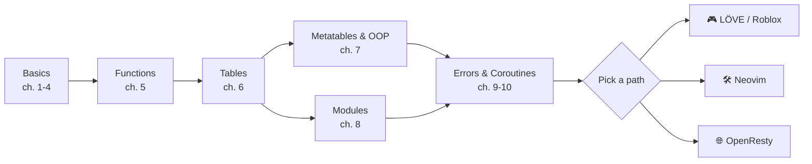

<div align="center">


# 🌙 Learn Lua

**A friendly, hands-on guide to the Lua programming language — from your first `print` to metatables and coroutines.**

[](https://www.lua.org)
[](LICENSE)
[](.github/workflows/test.yml)
[](CONTRIBUTING.md)

[Quick start](#-quick-start) •
[Chapters](#-chapters) •
[Cheatsheet](docs/cheatsheet.md) •
[Exercises](exercises/README.md) •
[Resources](#-where-to-go-next)

</div>

---

## ✨ Why Lua?

Lua (Portuguese for *moon*) is a small, fast, embeddable scripting language created in 1993 at PUC-Rio in Brazil. The whole interpreter fits in a few hundred kilobytes, yet it powers:

| Where | What |
|---|---|
| 🎮 **Games** | Roblox (Luau), World of Warcraft add-ons, LÖVE 2D, Defold, PICO-8 |
| 🛠️ **Tools** | Neovim config & plugins, Wireshark dissectors, Redis scripts |
| 🌐 **Web** | OpenResty / Nginx, Kong API gateway |
| 📦 **Embedded** | Any C/C++ app that needs a scripting layer |

If you can learn one language in a weekend, it's this one. **Lua has only 8 types and ~22 keywords.**

```lua
local function greet(name)
  return ("Hello, %s! 🌙"):format(name or "world")
end

print(greet("Lua"))   --> Hello, Lua! 🌙
```

---

## 🚀 Quick start

### 1. Install Lua

| OS | Command |
|---|---|
| macOS | `brew install lua` |
| Ubuntu / Debian | `sudo apt install lua5.4` |
| Windows | `winget install DEVCOM.Lua` or `scoop install lua` |
| Anywhere (no install) | [onecompiler.com/lua](https://onecompiler.com/lua) or the [official demo](https://www.lua.org/demo.html) |

Check it worked:

```bash
lua -v
# Lua 5.4.x  Copyright (C) 1994-20xx Lua.org, PUC-Rio
```

### 2. Clone this repo and run an example

```bash
git clone https://github.com/shiprzq/learn-lua.git
cd learn-lua
lua examples/01_hello.lua
```

### 3. Or play in the REPL

```bash
$ lua
> 2 ^ 10
1024.0
> #"moon"
4
```

---

## 📚 Chapters

Work through them in order — each takes about 10–20 minutes and ends with a runnable example.

| # | Chapter | You'll learn | Example |
|:-:|---|---|---|
| 1 | [Getting started](docs/01-getting-started.md) | Running Lua, comments, `print` | [`01_hello.lua`](examples/01_hello.lua) |
| 2 | [Variables & types](docs/02-variables-and-types.md) | `local`, the 8 types, `nil`, truthiness | [`02_types.lua`](examples/02_types.lua) |
| 3 | [Operators & strings](docs/03-operators-and-strings.md) | Math, `..`, string library, patterns | [`03_strings.lua`](examples/03_strings.lua) |
| 4 | [Control flow](docs/04-control-flow.md) | `if`, `while`, `repeat`, numeric & generic `for` | [`04_control_flow.lua`](examples/04_control_flow.lua) |
| 5 | [Functions](docs/05-functions.md) | Multiple returns, varargs, closures | [`05_functions.lua`](examples/05_functions.lua) |
| 6 | [Tables](docs/06-tables.md) | Arrays, dictionaries, `ipairs`/`pairs`, `table.*` | [`06_tables.lua`](examples/06_tables.lua) |
| 7 | [Metatables & OOP](docs/07-metatables-and-oop.md) | `__index`, operators, classes, inheritance | [`07_oop.lua`](examples/07_oop.lua) |
| 8 | [Modules](docs/08-modules.md) | `require`, writing your own module | [`08_modules.lua`](examples/08_modules.lua) |
| 9 | [Error handling](docs/09-error-handling.md) | `error`, `pcall`, `assert` | [`09_errors.lua`](examples/09_errors.lua) |
| 10 | [Coroutines](docs/10-coroutines.md) | `yield`/`resume`, generators | [`10_coroutines.lua`](examples/10_coroutines.lua) |
| 11 | [Gotchas & best practices](docs/11-gotchas.md) | 1-based indexing, globals, `#` with holes | — |

> 💡 **Tip:** keep the [**Cheatsheet**](docs/cheatsheet.md) open in another tab while you read.

---

## 🧩 Practice

Ten bite-sized [**exercises**](exercises/README.md) — FizzBuzz to a tiny class system — each with a [solution](exercises/solutions/).

```bash
lua exercises/solutions/01_fizzbuzz.lua
```

---

## 🗺️ Learning path



---

## 📖 Where to go next

- 📘 [Programming in Lua](https://www.lua.org/pil/) — the book, by Lua's creator Roberto Ierusalimschy
- 📄 [Lua 5.4 Reference Manual](https://www.lua.org/manual/5.4/)
- 🎮 [LÖVE](https://love2d.org) — make 2D games in Lua
- 🧱 [Roblox Creator Docs](https://create.roblox.com/docs/luau) — Luau, Roblox's Lua dialect
- ⌨️ [Neovim Lua guide](https://neovim.io/doc/user/lua-guide.html)
- 📦 [LuaRocks](https://luarocks.org) — Lua's package manager

---

## 🤝 Contributing

Found a typo or want to add a chapter? See [CONTRIBUTING.md](CONTRIBUTING.md). Every example is run automatically by GitHub Actions, so please keep them runnable.

## 📄 License

[MIT](LICENSE) © shipr

<div align="center">

**If this helped you, leave a ⭐ — it helps others find it!**

</div>
